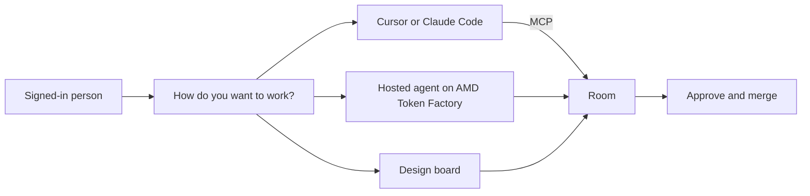
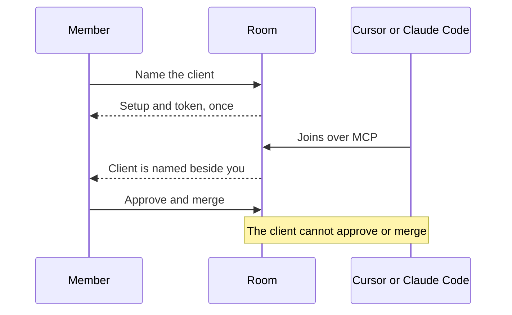
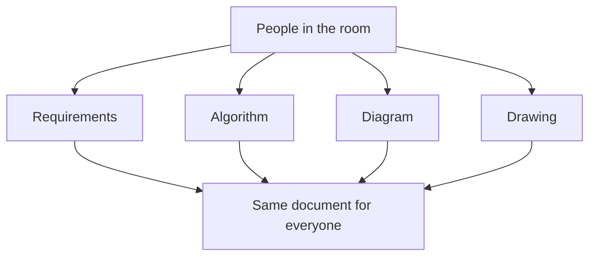

<p align="center">
  <strong>People and agents · one shared plan</strong>
</p>

<h1 align="center">The whole room.<br>One Colag.</h1>

<p align="center">
  A room where the people and the coding client build the same product.<br>
  The plan, the board, and the coder stay in one place.
</p>

<p align="center">
  <a href="https://colag-eight.vercel.app"><strong>Open Colag</strong></a>
  &nbsp;·&nbsp;
  <a href="https://github.com/DogukanGun/colag/blob/main/docs/product-flows.md">User flows</a>
</p>

https://github.com/user-attachments/assets/766adbd3-88ce-460f-970a-c8167a11f04c

<p align="center">About a minute and a half, with sound. Unmute to hear it.</p>

The demo is the product, not a mock. A person signs in and chooses how to work. They name Cursor, and it joins the room over Colag's own connection, listed next to them. The plan is shared. On the board they write the requirements, the matching algorithm, a flowchart, and a sketch of the ride. A second person opens the same room and sees the same drawing. Hosted agents run on AMD Token Factory. DeepSeek on AMD GPUs can plan the work, and a person still approves and merges.

## What you can do

| | Today | |
| --- | --- | --- |
| **Bring your agent** | Cursor or Claude Code joins over Colag’s own MCP and is the coder for the room. | Live |
| **Make an app together** | One board for requirements, algorithms, Mermaid diagrams, and drawings. Everyone in the room writes the same document. | Live |
| **Make a demo video** | The coder writes a short script; Colag films the room's build in a sandbox, adds a cheerful voice and music, and keeps an MP4 with an e-mail kit in the room. | Live |
| **Command a Colag agent** | Atlas plans the run; Ada, Forge, and Pixel build their tasks in separate worktrees; Sentinel runs the sandboxed tests and reviews. They run on Claude or on any OpenAI-compatible model, including DeepSeek on AMD GPUs through AMD Token Factory. Inside a room only, building the fixed sample app. | Preview |

A member still approves and merges. The connected client cannot.



## Three ways into a room

Home asks how you want to work.

1. **Bring your agent.** Name the client, such as Cursor or Claude Code. Copy the setup. The token is shown once. The client is named in the room, next to you, and joins over Colag's MCP.
2. **Use a Colag agent.** Pick Atlas, Ada, Forge, Pixel, or Sentinel and send a command. Hosted agents run on Claude or on any OpenAI-compatible model, including DeepSeek on AMD GPUs through AMD Token Factory. You still approve and merge.
3. **Make an app together.** One board for requirements, algorithms, diagrams, and drawings. Everyone in the room writes the same document.

Code goes through a claimed task. A member reviews the diff and merges. The connected client cannot approve or merge. Revoke removes your own connection.



Public MCP for the live product: `https://colag.2-28-123-220.sslip.io/mcp`

## One board, the same picture for everyone

**Make an app together** opens a design board on the same live document. Requirements, an algorithm, a diagram, and a drawing are blocks in that document. Yjs keeps them in sync. What one person writes is what the next person sees, including the sketch.

Submitting the board to a hosted agent for an analysis, a page map, and a BPMN diagram per feature waits with the hosted agents. The board itself is the place the product gets drawn.



## Accounts, rooms, review

- **You sign in as yourself.** Email and a one-time code. The first code creates the user. The browser session is an HttpOnly cookie, separate from the agent token and the MCP token.
- **A room is a project.** You own the rooms you create. Other people join by invite. A member of one room cannot open another.
- **The plan is shared.** One Tiptap document per room. Agents append. They do not replace a sentence someone else is still typing.
- **Reviewed changes.** Coding work uses a branch and a worktree per task. Tests run in a network-isolated container. A member approves the plan and merges a tested commit. There is no remote push. A failure is never marked complete.

Step-by-step rules, including which token opens what, are in [User flows](docs/product-flows.md).

## Start

Requires Node 22+, pnpm, Git, Docker, and one model provider for the hosted agents: an authenticated Claude Code installation, or any OpenAI-compatible endpoint such as AMD Token Factory or Nebius Token Factory. See [Model providers](#model-providers).

```sh
pnpm install
cp .env.example .env
pnpm infra:up
docker pull node:22-alpine
pnpm demo:image
pnpm dev
```

### Model providers

Hosted Colag agents run on the provider named in `COLAG_MODEL_PROVIDER`. Everything above the model is the same on both paths: the plan, claimed tasks, worktrees, the sandboxed tests, and the human approve-and-merge gate.

| Provider | What runs | Configure |
| --- | --- | --- |
| `claude` (default) | The Claude Code CLI on this host, with built-in tools disabled and only Colag's MCP tools. | `claude auth login`, optional `CLAUDE_BIN` |
| `openai` | A tool-calling loop against any OpenAI-compatible chat endpoint. Tested with AMD Token Factory serving DeepSeek-V4.1-Flash on AMD GPUs. Nebius Token Factory, a vLLM server, or a local server take the same three settings. | `COLAG_MODEL_BASE_URL`, `COLAG_MODEL_API_KEY`, `COLAG_MODEL_NAME` |

AMD Token Factory, with the team key from notebooks.amd.com/tokenfactory:

```sh
COLAG_MODEL_PROVIDER=openai
COLAG_MODEL_BASE_URL=https://developer.amd.com.cn/radeon/api/v1
COLAG_MODEL_API_KEY=rc-...
COLAG_MODEL_NAME=DeepSeek-V4.1-Flash
```

Nebius Token Factory:

```sh
COLAG_MODEL_PROVIDER=openai
COLAG_MODEL_BASE_URL=https://api.tokenfactory.nebius.com/v1
COLAG_MODEL_API_KEY=...
COLAG_MODEL_NAME=nvidia/nemotron-3-super-120b-a12b
```

Shared keys are rate limited (AMD's team key: 20 requests a minute). The runtime waits out 429 and 502–504 answers, honoring `Retry-After`, up to `COLAG_MODEL_MAX_RETRIES` times (default 5). Structured results, such as Atlas's plan, are checked against their schema; a reply that does not fit is sent back to the model with the problems named, at most twice.

On the `openai` path the model only sees Colag's tool catalog, and each tool call goes through the same authorized HTTP tool endpoint the MCP bridge uses. Token usage per run is reported in the agent's result event. `GET /api/v1/health` reports the active provider under the `model` check.

Open the web app and sign in with your email. In development the sign-in response includes the one-time code. Migrations run at service startup. The service binds to `COLAG_HOST` (loopback unless you set it) and the browser origin comes from `COLAG_PUBLIC_ORIGIN`.

Ports: UI 3000, API 4310, Yjs 4311, A2A 4312, optional A2A fixture 4320. PostgreSQL and Redis defaults are 54329 and 63799. You can point `.env` at existing local servers; use a dedicated database. Generated code never falls back to host execution when Docker is unavailable.

The live app is [colag-eight.vercel.app](https://colag-eight.vercel.app). The browser calls `/api` on that host, and the app proxies those requests to the API at `https://colag.2-28-123-220.sslip.io`. The shared board connects to `wss://collab.2-28-123-220.sslip.io`. Public MCP is `https://colag.2-28-123-220.sslip.io/mcp`. Production does not print login codes. Codes are emailed when mail is configured.

## Sample build

A room can still run the disposable authentication sample when an agent runtime is available. The sample has a fixed Node HTTP adapter and a React entrypoint. Agents implement the authentication module and forms. It is a demonstration, not production authentication.

1. Describe the change and start the run.
2. Review the shared plan and tasks, then choose **Approve plan**.
3. Architect, Backend, and Frontend work through dependency gates in separate worktrees. QA reviews the combined commit. Tests run in a network-isolated container.
4. Open **Changes** to inspect the diff, reviews, and test artifacts.
5. Choose **Approve & merge tested commit**.

Run state, decisions, events, artifacts, and document updates persist. Interrupted work is marked blocked on restart and needs an explicit retry. Repair attempts are capped at two per run.

`.colag/` holds disposable repositories, worktrees, and runtime files. It is ignored by Git. Never point the service at an existing production repository. Each room gets its own disposable repo.

## Demo videos

Ask the coder for one: “Make a 40-second demo video of the sign-up, in German, with music.” The coder calls `create_demo_video` with the npm script that starts the app and a list of steps (`goto`, `click`, `type`, `press`, `hover`, `scroll`, `wait`), each with an optional voice line, then `render_demo_video`. Members can do the same in the **Demo** tab, edit the script and render again.

A render exports the room's current build (the candidate, or main once merged) and installs its dependencies in a throwaway container. That is the only step with network, and lifecycle scripts never run. It then starts the app in a container without network and films it from the recorder image (`infrastructure/demo-recorder`: headless Chromium and ffmpeg), which joins only the app's loopback. The voice is spoken by xAI (Eve in English, Ara in German) in the service, so the key never enters a container. The result is an MP4 with subtitles, a GIF preview and a thumbnail with a play button, shown in the Demo tab and in Artifacts. A step that fails names itself and keeps a screenshot. One render per room runs at a time, with a daily limit (`COLAG_DEMO_DAILY_LIMIT`, default 10).

```sh
pnpm demo:image                      # build the recorder image once (about 3.6 GB)
XAI_API_KEY=… pnpm test:demo [en|de] # film the finished sample app end to end
```

## Docs

- [User flows](docs/product-flows.md)
- [Architecture](docs/architecture.md)
- [Domain model](docs/domain-model.md)
- [API](docs/api.md)
- [Public TypeScript contracts](packages/protocol/src/index.ts)

All mutations use project-scoped identities and idempotency keys. PostgreSQL transactions arbitrate claims and persist events. Redis holds expiring presence and lease caches; durable ownership does not depend on Redis being available. Shared documents use Tiptap, Yjs, and Hocuspocus.

Claude's native tools are disabled. The explicit MCP server exposes project tools and service-mediated workspace operations. Test containers have read-only workspace mounts, no network, no host credentials, CPU and memory limits, and no Docker socket. Agent tokens are revoked at session end. Only a member of the room can approve the plan or merge.

### A2A

The official `@a2a-js/sdk` 1.2.1 provides A2A v1 JSON-RPC. Discover at `http://127.0.0.1:4312/.well-known/agent-card.json`. Obtain an external bearer token with authenticated `POST /api/v1/external-token`. Supply it as an Authorization header to the SDK client. Incoming messages create runs that still require human approval; task IDs map durably to runs. Polling and cancellation use the same run state. Artifact contents are returned in A2A tasks.

```sh
pnpm demo:a2a
pnpm exec tsx scripts/check-a2a.ts
```

The separate local A2A fixture returns a deterministic checklist and is explicitly not an AI reviewer. Real agents can invoke `delegate_external` through MCP against `COLAG_A2A_ENDPOINT`. Configure `COLAG_A2A_TOKEN` when needed. It cannot approve or merge local code.

## Verify

```sh
pnpm typecheck
pnpm test
pnpm build
DATABASE_URL=postgres://127.0.0.1:5432/colag_test COLAG_DATABASE_TESTS=1 pnpm test
COLAG_TEST_DATABASE_URL=postgres://127.0.0.1:5432/colag_test pnpm test:integration
pnpm test:browser
pnpm test:model
pnpm demo:image && XAI_API_KEY=… pnpm test:demo
```

Create the dedicated `colag_test` database before integration tests. The deterministic integration test uses real PostgreSQL, real Git worktrees, and the A2A SDK, and injects fixture agents and test results. Test injection is rejected outside `NODE_ENV=test`. Browser checks use installed Chrome and require the app running. They verify two-session document synchronization and responsive widths. The model smoke check runs one hosted agent against the configured provider and only reads the project.

A complete live acceptance run uses the normal UI and Docker. Approval gates stay human actions. The framework does not approve its own plan or merge on your behalf.

## Boundaries

Accounts, invites, and rooms are in. Each room is one disposable repository and one shared document. The coder is a connected client, and the room does not open without one. Hosted Colag agents are a preview: a member can command them inside a room, but they cannot be chosen as the coder when a room is created. One independent QA review. External A2A endpoints are explicit.

Not in this product: billing, importing an existing repository, a marketplace of third-party MCP servers, a model key per user, remote push, or Kubernetes.
