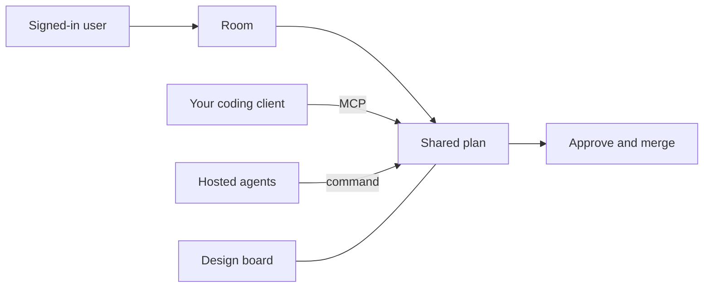
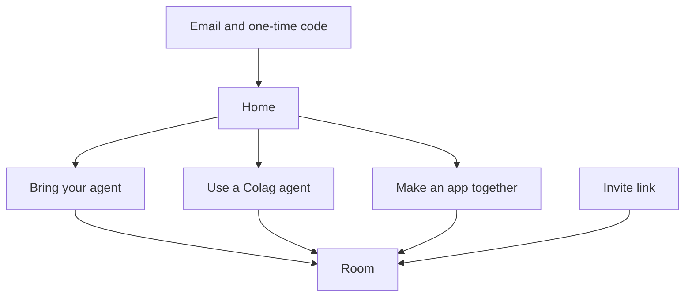
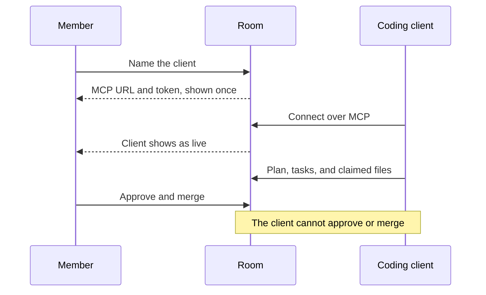
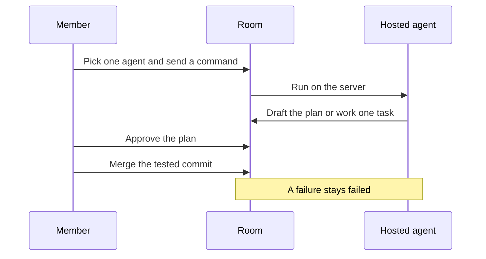
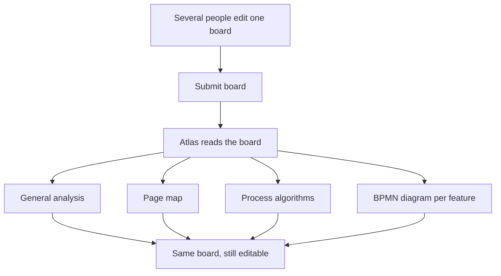

# Colag

Colag is a room where people and agents write and build together. You sign in as yourself, open a room, and pick how to work: bring your own coding client, command an agent Colag hosts, or design an app on one shared board. Plans stay in a live document several people can edit at once. Code stays on isolated branches until a member approves the plan and merges a tested commit.

## Features

- **Accounts.** Email and a one-time code. The first code creates the user. The browser session is an HttpOnly cookie, separate from agent and MCP tokens.
- **Rooms.** You own the rooms you create. Other people join only by invite. A member of one room cannot open another.
- **Shared plan.** One Tiptap document per room, synced live with Yjs. Agents append sections and do not replace what someone else is typing.
- **Bring your agent.** Cursor or Claude Code joins the room over Streamable HTTP MCP. The token is shown once and can be revoked. The client can work the plan, tasks, and claimed files. It cannot approve or merge.
- **Hosted agents.** Atlas, Ada, Forge, Pixel, and Sentinel run on the server with the server’s Claude login. You pick one and send a command. The room log is the transcript.
- **Make an app together.** The same shared document is a design board: notes, algorithms, Mermaid diagrams, and small drawings. Submit asks Atlas to append an analysis, a page map, process algorithms, and a BPMN-style diagram per feature.
- **Reviewed changes.** Coding work uses a branch and worktree per task. Tests run in a network-isolated container. A member approves the plan and merges. There is no remote push.

Step-by-step rules, including which token opens what, are in [User flows](docs/product-flows.md).



## Ways in

Sign in, then choose one of these on the home screen. Each choice creates a room. Rooms you already belong to are listed underneath.



### Bring your agent

1. Name the client, such as Cursor or Claude Code.
2. Copy the MCP URL, the token, and the config snippet. The token is shown once.
3. Connect the client. It appears in the room while it is live.
4. Write the plan together. Code goes through a claimed task, then a member reviews the diff.
5. Revoke the connection when that client should stop.



### Use a Colag agent

1. Pick one hosted agent.
2. Send a command. Atlas can draft the shared plan. A specialist works one ready task in its own worktree.
3. Watch the room log. Stop leaves the run blocked or stopped. A failure is never marked complete.
4. Approve the plan, inspect **Changes**, then merge the tested commit. Only that room’s disposable `main` changes.



### Make an app together

1. Open the board and write the product with the other people in the room. Add requirements, an algorithm, or a diagram.
2. Choose **Submit board**.
3. Atlas appends a general analysis, a page map, process algorithms, and one BPMN-style diagram per feature.
4. Keep editing the same document. The append does not wipe notes someone else is still writing.

If Claude cannot run, the submit is blocked and the error is the real one. Colag does not invent an analysis.



## Start

Requires Node 22+, pnpm, Git, Docker Desktop, and an authenticated Claude Code installation.

```sh
pnpm install
cp .env.example .env
pnpm infra:up
docker pull node:22-alpine
claude auth status
pnpm dev
```

Open the web app and sign in with your email. In development the sign-in response includes the one-time code. Migrations run at service startup. The service binds to `COLAG_HOST` (loopback unless you set it) and the browser origin comes from `COLAG_PUBLIC_ORIGIN`.

Ports: UI 3000, API 4310, Yjs 4311, A2A 4312, optional A2A fixture 4320. PostgreSQL and Redis defaults are 54329 and 63799. You can use existing local PostgreSQL/Redis servers by setting `.env`; use a dedicated database. Service startup errors appear in the page. Generated code never falls back to host execution when Docker is unavailable.

## Sample build

A room can still run the disposable authentication sample. The sample has a fixed Node HTTP adapter and React entrypoint. Agents implement the authentication module and forms. It is a demonstration, not production authentication.

1. Describe the change and start the run.
2. Review the shared plan and tasks, then choose **Approve plan**.
3. Architect, Backend, and Frontend work through dependency gates in separate worktrees. QA reviews the combined commit. Tests run in a network-isolated container.
4. Open **Changes** to inspect the diff, reviews, and test artifacts.
5. Choose **Approve & merge tested commit**.

Run state, decisions, events, artifacts, and document updates persist. Interrupted work is marked blocked on restart and needs an explicit retry. Repair attempts are capped at two per run.

`.colag/` holds disposable repositories, worktrees, and runtime files. It is ignored by Git. Never point the service at an existing production repository. Each room gets its own disposable repo.

## Docs

- [User flows](docs/product-flows.md)
- [Architecture](docs/architecture.md)
- [Domain model](docs/domain-model.md)
- [API](docs/api.md)
- [Public TypeScript contracts](packages/protocol/src/index.ts)

All mutations use project-scoped identities and idempotency keys. PostgreSQL transactions arbitrate claims and persist events. Redis holds expiring presence and lease caches; durable ownership does not depend on Redis being available. Shared documents use Tiptap/Yjs/Hocuspocus. Agents append sections rather than replacing concurrent human edits.

Claude's native tools are disabled. The explicit MCP server exposes project tools and service-mediated workspace operations. Test containers have read-only workspace mounts, no network, no host credentials, CPU/memory limits, and no Docker socket. Agent tokens are revoked at session end. Only a member of the room can approve the plan or merge. A connected coding client cannot.

### A2A

The official `@a2a-js/sdk` 1.2.1 provides A2A v1 JSON-RPC. Discover at `http://127.0.0.1:4312/.well-known/agent-card.json`. Obtain an external bearer token using authenticated `POST /api/v1/external-token`. Supply it as an Authorization header to the SDK client. Incoming messages create runs that still require human approval; task IDs map durably to runs. Polling and cancellation use the same run state. Artifact contents are returned in A2A tasks.

```sh
pnpm demo:a2a
pnpm exec tsx scripts/check-a2a.ts
```

The separate local A2A fixture returns a deterministic checklist and is explicitly not an AI reviewer. Real agents can invoke `delegate_external` through MCP against `COLAG_A2A_ENDPOINT`; configure `COLAG_A2A_TOKEN` when needed. It cannot approve or merge local code.

## Verify

```sh
pnpm typecheck
pnpm test
pnpm build
DATABASE_URL=postgres://127.0.0.1:5432/colag_test COLAG_DATABASE_TESTS=1 pnpm test
COLAG_TEST_DATABASE_URL=postgres://127.0.0.1:5432/colag_test pnpm test:integration
pnpm test:browser
pnpm test:claude
```

Create the dedicated `colag_test` database before integration tests. The deterministic integration test uses real PostgreSQL, real Git worktrees and the A2A SDK, but injects fixture agents and test results. Test injection is rejected outside `NODE_ENV=test`. Browser checks use installed Chrome and require the app running; they verify two-session document synchronization and responsive widths. The Claude smoke check uses your real authenticated account and only reads the project.

A complete live acceptance run uses the normal UI and Docker. Approval gates intentionally remain human actions. The framework does not approve its own generated plan or merge on your behalf.

## Current boundaries

Accounts, invites, and rooms are in. Each room is one disposable repository and one shared document. One independent QA review. External A2A endpoints are explicit. Hosted agents use the server’s Claude login, not a key per user.

Not in this repo yet: billing, importing someone’s existing repository, a marketplace of third-party MCP servers, remote push, production deployment, or Kubernetes.
