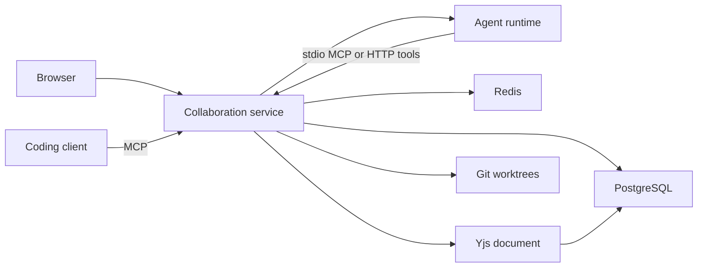

# Architecture

Colag is a modular monolith: a Next.js client, a Fastify collaboration service, and a supervised agent runtime with two interchangeable model providers: the Claude Code CLI, or any OpenAI-compatible chat endpoint such as AMD Token Factory, Nebius Token Factory, or a vLLM server. PostgreSQL owns users, sessions, room memberships, structured resources, and the transactional event log. Redis owns transient presence and leases. Hocuspocus persists Yjs documents in PostgreSQL. Git owns source code. The browser never controls domain transitions directly.

People sign in with an email code. The browser session is an HttpOnly cookie, not an agent credential and not an MCP token. A human actor is built per request from that user. It has no baked-in room and no wildcard permission. `authorize` allows a human action only when that user is a member of the room in the URL. See [product-flows.md](product-flows.md) for the ways into a room and which token opens what.

The protocol and domain packages contain no UI, ORM, A2A, or MCP imports. REST, MCP, and A2A adapters call the same authorized command service. Hosted agents still use a per-run bearer in `credentials`, bound to one room and one run. External coding clients use a revocable bearer stored only as a hash on `mcp_connections`. That Streamable HTTP MCP exposes the collaboration tools and does not include plan approval or merge. A session cookie cannot authenticate MCP, and an agent token cannot open the UI.

The service binds to `COLAG_HOST` (loopback by default). Browser CORS uses `COLAG_PUBLIC_ORIGIN`. Unauthenticated requests fail. The live web app is https://colag-eight.vercel.app and proxies `/api` to https://colag.2-28-123-220.sslip.io. Room MCP is that same host at `/mcp`. The shared board uses a separate websocket at wss://collab.2-28-123-220.sslip.io, which is the Hocuspocus port. The runtime package exposes `runAgent` and `preflight`; `COLAG_MODEL_PROVIDER` selects the provider. With `claude`, Claude Code runs on the host for existing authentication, with built-in tools disabled, project configuration discovery disabled, and only explicitly provided MCP tools through the stdio MCP bridge. With `openai`, the runtime drives a chat-completions tool loop: the catalog's zod schemas become tool definitions, each tool call posts to the service's authorized tool endpoint with the agent's per-run bearer, tool errors are returned to the model, and structured outputs are parsed from the final message with one schema-constrained formatting pass as a fallback. Both providers emit the same output line shapes, so the engine, event log, and UI do not know which model is active. MCP mediates reads and writes within an assigned worktree, rejecting traversal, symlinks, and Git metadata. Git commands are service-owned. Generated code runs only in Docker, without network, host secrets, or the Docker socket. The Docker daemon is trusted infrastructure, not mounted into a worker.

Coding tasks use distinct branches and worktrees. The service assembles their commits onto an integration branch, tests the exact candidate, and requests independent QA review. Human merge requires matching candidate, test, and review SHAs and an unchanged target HEAD. Conflicts are recorded and routed to a repair task. No remote push exists. `agent.prompt` runs one hosted agent; it can draft a plan or work one task, and it cannot approve or merge. `board.submit` asks Atlas to append a stranger-readable analysis of the shared design board. That write appends. A model failure is stored on a blocked run and is not replaced with a made-up analysis.

Yjs is the only document text owner. Structured task and decision records appear alongside the editor instead of being duplicated as editable custom nodes. Agent document replacement uses Yjs transactions. Durable events use monotonically increasing sequence numbers and support SSE replay; periodic replay polling avoids losing notifications across a service crash. Redis failure makes live presence unavailable but cannot authorize duplicate durable task ownership.

A2A is a gateway for discovery, task exchange, cancellation, status, and artifact exchange, not the internal domain model. MCP is the agent-facing tool adapter, not the protocol itself. Use official SDK bindings rather than hand-written wire formats. External A2A endpoints are explicit configuration. Billing, importing an existing repository, a marketplace of third-party MCP servers, and per-user model keys are deferred. Each room still gets its own disposable Git repo. Hosted agents use the configured model provider: Claude Code on the host, or the OpenAI-compatible endpoint in `COLAG_MODEL_BASE_URL`, including AMD Token Factory.

Alternatives: SQLite would simplify setup but not exercise PostgreSQL concurrency; browser storage would not prove durable collaboration; shared writable checkouts would defeat isolation; separate microservices would add operational cost without improving this slice.
