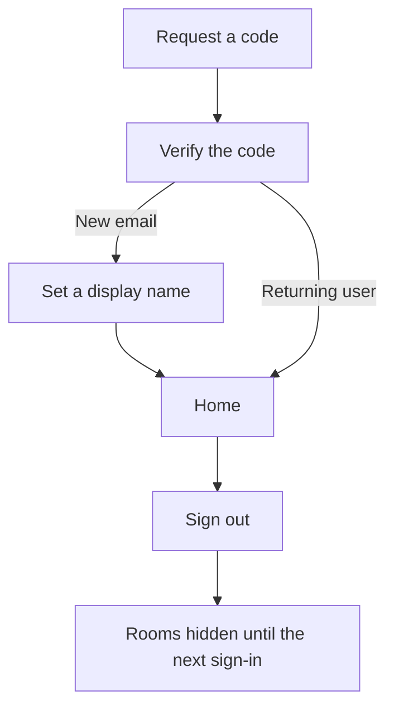
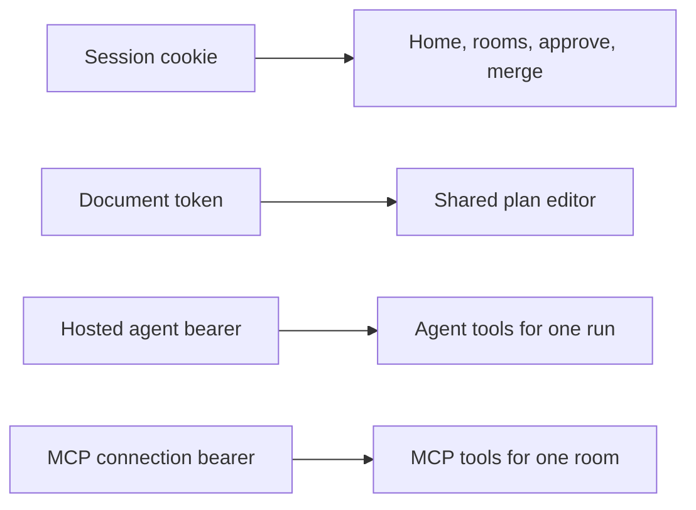
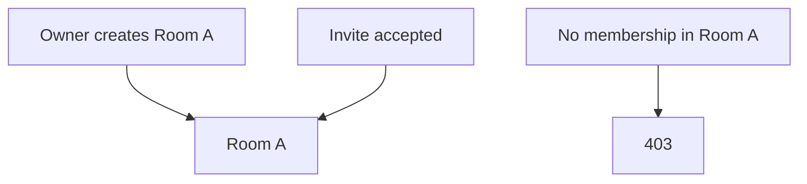

# User flows

Colag is a room. A person signs in, then brings their own coding client, commands an agent Colag hosts, or makes an app together on one board. The coding paths share a plan, claimed tasks, isolated worktrees, and a human approve/merge gate. The board is that same shared plan.

What you see in the app:

1. Enter an email. In development the next response includes the code. The first successful code asks for a display name and creates the account.
2. Home asks how you want to work. The three choices are below. Rooms you already belong to are listed under them.
3. Inside a room, the people column shows members, connected clients, and hosted agents that are actually present. The center is the shared plan or design board. **Changes** appears once there is a candidate commit.
4. Sign out revokes the browser session. The room is not visible again until you sign in.

The rest of this page is the rule for each path. The GitHub overview is the [README](../README.md).

## User

There is no shared local person. The first successful code for an email creates a user. The display name is asked once and can be changed later.

`POST /api/v1/auth/request` stores a short-lived single-use code. In development the response includes the code. When `COLAG_SMTP_HOST` is set, the code is emailed and left out of the response.

`POST /api/v1/auth/verify` consumes the code, creates the user when the email is new, and sets an HttpOnly `colag_session` cookie. `POST /api/v1/auth/logout` revokes that session. `GET /api/v1/me` returns the signed-in user.

A wrong code, an expired code, and a code that was already used are different errors. A second verify of the same code fails.

## Tokens

| Token | Opens | Cannot |
| --- | --- | --- |
| `colag_session` cookie | The UI: home, rooms, invites, commands, approve, merge | MCP |
| Document token | The shared plan editor for one room | Approve, merge, or `/me` |
| Hosted agent bearer | That agent’s tools for one room and one run | The UI, approve, merge |
| MCP connection bearer | Streamable HTTP MCP for one room | Approve, merge, and any other room |
| External A2A bearer | Read, start, and stop a run in one room | Approve and merge |

A session cookie is not an MCP credential. An agent token is not a session: `GET /api/v1/me` rejects it. MCP tokens are stored only as a hash and stop working when the connection is revoked.

## Rooms

A signed-in user creates a room and becomes its owner. Someone else joins only by accepting an invite. Membership is the only way in. A member of room A who requests room B gets 403.

A room is still a project internally, so events, documents, runs, and worktrees keep their current ids. Each room gets its own disposable Git repository on the server. The service binds to `COLAG_HOST` and allows the browser origin in `COLAG_PUBLIC_ORIGIN`. Unauthenticated requests still fail.

## Bring your agent

A member names a client and receives the MCP URL, a token once, and a config snippet for Cursor and for Claude Code. The client speaks Streamable HTTP MCP. A heartbeat marks that person and client live in the room, for example “Ada Lovelace · Cursor”.

The remote tools can inspect the room, read and append the plan, work with tasks, decisions, and artifacts, and list, read, or write files. File writes stay inside the claimed task’s allowlist. The client cannot approve a plan or merge.

## Use a Colag agent

The hosted roster is Atlas, Ada, Forge, Pixel, and Sentinel. A member picks one and sends `agent.prompt`. Colag runs that agent with the current Claude runtime and the in-process MCP bridge. The room event log is the transcript: the command, status, tool activity, and the resulting task or plan edit.

Atlas can draft the shared plan. Approval stays a separate human action in the room. A specialist works one ready task in that task’s worktree. Stop, block, and retry keep their current behavior. A failure is never marked complete. The connected client and the hosted agent both stop short of approve and merge.

## Make a demo video

The coder or a member writes a script for the room's current build: `app.start` (the npm script, plus `app.api.start` for a separate API) and its port, then up to 40 steps. Each step is `goto` (a path inside the app), `click`, `type`, `hover`, `press`, `scroll` or `wait`, with an optional `say` line of at most 40 words. Colag checks the script when it is saved and returns readable errors (`steps.3: click needs a target`). It also checks, before rendering, that the npm scripts exist in that build's `package.json`.

`render_demo_video` (or **Render** in the Demo tab) queues it. The room sees the progress live: the voice, installing, starting the app, filming step 7 of 18, cutting to the voice, mixing. The app runs without network. The recorder sees only the app. A ready demo shows a player and downloads (MP4, GIF, thumbnail, subtitles) and adds a video artifact. A failed one says which step failed and why, with a screenshot; fix that step and render again. Editing a demo puts it back to draft. One render per room at a time, and a daily limit per room.

The coder can create, edit and render demos, but it cannot approve or merge, and it cannot see another room's demos. Files are served only to members of the room.

## Make an app together

A member chooses this on the home screen. Colag creates a room and opens the shared plan as a design board. Several people edit that one document at the same time: prose, a requirements block, an algorithm, a Mermaid diagram, or a small drawing. The diagram source is the shared text. The same document token that opens the plan opens the board.

Submit is `board.submit`, and only a member of the room can send it. Colag reads the board and asks Atlas, the coordinator, to append four sections with `write_document`: a general analysis a stranger can understand, a page map, process algorithms, and one BPMN-style diagram per feature. The append does not replace what people are still writing. People keep editing the same document after Atlas writes.

The room shows that submit as idle, working, or blocked. New sections arrive on the board through the document sync, and the status arrives through the room snapshot. If the model cannot run, the run is blocked and keeps the real error. Colag does not invent an analysis when the model does not run.
